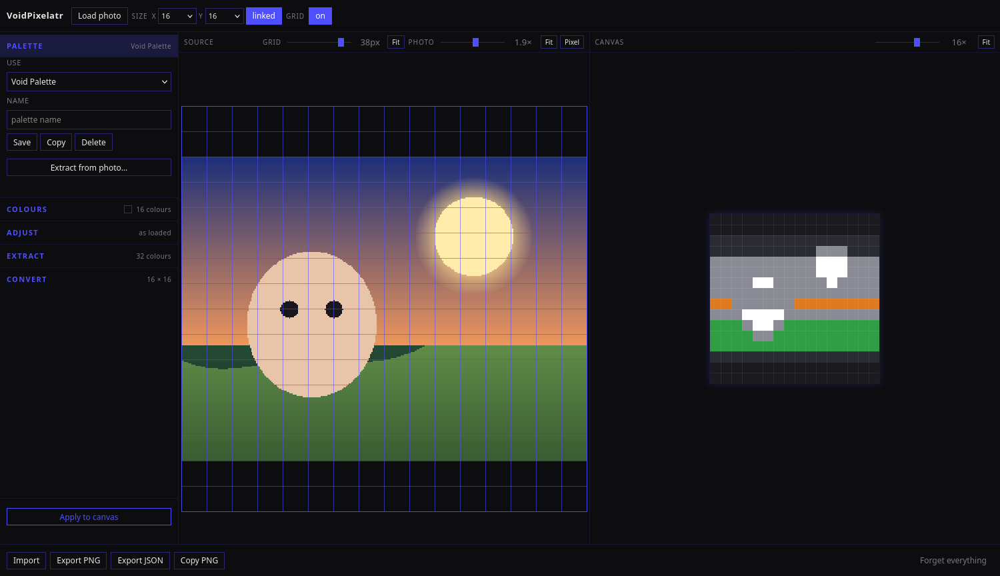
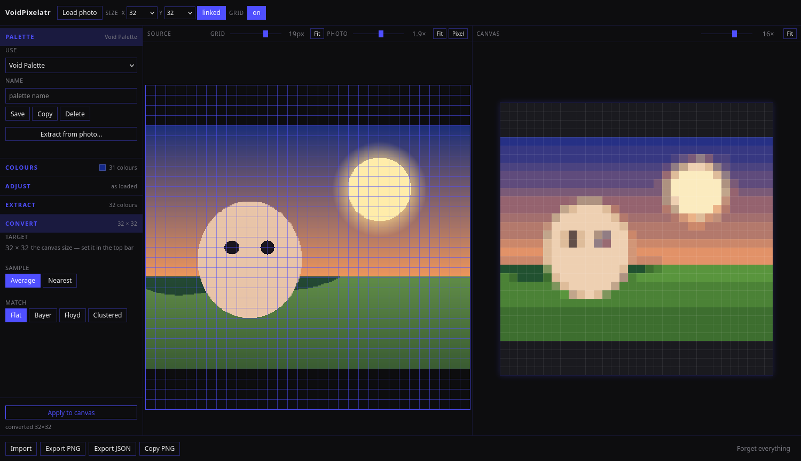

# VoidPixelatr

**A photo becomes pixel art.**

Load a photo, frame it under a grid, adjust it, pull a palette out of it,
convert it. It all happens in your browser — no build step, no dependencies,
no server, no upload.



---

## What it does

The app is a **pipeline**, and it runs in one direction:

1. **Load a photo** — from the file picker, by dropping it anywhere on the
   page, or by pasting it. It is decoded in the browser and never leaves it.
2. **Frame it under a grid** — pan and zoom the photo against a grid that
   decides which part of it gets converted. The grid is a view of its own:
   it pans and zooms independently of the photo, down to a single pixel per
   cell, so a 512×512 grid still fits on the screen.
3. **Adjust it** — black and white point, brightness, contrast, saturation,
   hue shift, greyscale, and auto-levels. These run *before* sampling, which
   is the difference between a washed-out photo that pixelates to mud and
   one that pixelates to a sprite.
4. **Extract a palette** — pull 16, 32 or 64 colours out of the photo, then
   tune them for sprites with their own saturation, brightness, contrast,
   hue and posterise sliders, and a set of presets. The extraction is staged:
   nothing changes until you say so.
5. **Convert** — the photo is sampled cell by cell and each cell is matched
   to the palette, by area average or nearest, with flat, Bayer, Floyd–Steinberg
   or clustered matching.

Every control re-renders the result **while you drag it**, on the canvas
itself — the live conversion is a layer over the artwork, in the very same
canvas the result lives in.



## Features

- **One menu, on the left.** Palette, colours, adjustments, extraction and
  conversion are five sections that drop open. The colours are a pop-over,
  because a sixty-four swatch grid is taller than the whole menu.
- **Palettes that ship built in.** The Void Palette (16), Void Expanded (32)
  and Void Full (64) are nested, so switching between them never disturbs
  your result. Twelve hue families, each with the same depth in every
  palette — every hue has a ramp to shade with. Build your own at 16, 32
  or 64 and edit it colour by colour.
- **Rectangular output.** An X and a Y, each 16, 32, 64, 128, 256 or 512. A
  rectangle is as ordinary as a square, and a photo's aspect ratio often is
  not a square's. A lock button ties the two edges together when you want
  one.
- **Zoom everywhere.** The photo, the grid and the canvas each have their
  own zoom, and none of them touches the others.
- **Import and export.** PNG at five scales with a transparent or solid
  background, JSON round-trips that reload the project exactly, and JSON
  import that reads older files too.
- **Keyboard shortcuts**, and a `Forget everything` button that clears every
  trace of your work in one click.

## What it is not

There is no brush. No eraser. No symmetry. No stroke undo. No layers. The
canvas is written by the converter and read by the exporter, and by nothing
else.

Making pixel art **by hand** is a different tool's job. The two share the
project-file format, so a conversion made here opens there and an artwork
made there opens here — and they share nothing else.

## The promise

Your photo is decoded in your browser, drawn to a canvas, and read back into
memory. There is no `fetch`, no `XMLHttpRequest`, no `sendBeacon`, no
`blob:` URL, no form, and no endpoint to send anything to. A full pipeline
run makes requests for the app's own files and nothing else.

This is enforced by architecture, not by a promise in a README: there is no
upload endpoint to abuse, because there is no server at all.

Your work *is* stored — on your own machine, in `localStorage` and IndexedDB,
never on a server. **Forget everything** wipes the lot in one click.

## Running it

It is a folder of static files. There is nothing to install.

```bash
./serve.sh          # http://127.0.0.1:8792
```

Or just open `index.html` — it works over `file://` too.

To publish it as a static site, point any web server at the folder. It needs
no runtime, no backend and no database. If you serve it with nginx, the
included `ops/nginx/voidpixelatr.conf` is a working single-site vhost.

## Testing

```bash
node tests/voidpixelatr.test.mjs   # 141 logic checks, no dependencies

python3 tools/make-test-images.py /tmp/vp-images
python3 tests/browser/e2e.py        # 101 end-to-end checks in a real Firefox
python3 tests/browser/hostile.py    # 33 hostile-input checks
```

The browser suites drive a real Firefox over Marionette — a minimal client
in `tests/browser/marionette.py`, with no geckodriver and no npm. Nothing is
mocked: they load a real PNG through a real file input, read the real
`performance` resource timings to prove the pipeline made no network
request, and write the exported files to disk to check them.

### Testing under a Content-Security-Policy

A plain `python3 -m http.server` sends no CSP at all, which is a weaker test
than it looks. `tests/browser/csp_server.py` sends a real
`Content-Security-Policy` — with `script-src 'self'` — parsed out of the
real header file rather than transcribed, so it cannot drift from what a
server will send.

```bash
python3 tests/browser/csp_server.py --port 8793 &
python3 tests/browser/e2e.py --base http://127.0.0.1:8793
python3 tests/browser/hostile.py --base http://127.0.0.1:8793
```

Both suites pass either way. That is the point — the app has no inline
script and no inline event handler, so `script-src 'self'` allows it.

## How it is built

- **Vanilla HTML, CSS and JavaScript.** No framework, no bundler, no build
  step, no TypeScript, no npm, no dependencies. The source you read is the
  source that runs.
- **A layered buffer model, not DOM nodes.** The art and the live preview
  are offscreen canvases at art resolution; the visible canvas composites
  them. A 256×256 canvas is 65,536 cells and stays responsive.
- **Plain `<script src>` tags**, each file exposing one namespace object
  (`VP`, `VP.canvas`, `VP.palette`, …). No inline script and no inline event
  handler, because the CSP forbids both.

```
index.html          the markup
css/style.css       every style and every token
js/quantise.js      the pure algorithm layer — no DOM
js/palette.js       the palette model
js/storage.js       localStorage and IndexedDB
js/canvas.js        the buffers, the compositing, the zoom
js/reference.js     the source layer and the adjustments
js/io.js            PNG and JSON export, JSON import
js/workspace.js     the pipeline
js/menu.js          the menu and the colour pop-over
js/app.js           the bootstrap
```

## The specification

[`project.md`](project.md) is the single source of truth: the architecture,
every decision, the walkthroughs and the acceptance criteria.

[`AGENTS.md`](AGENTS.md) is the handoff document for anyone working on the
code — what the project is, what it is not, how to test it, and the
gotchas that have bitten before.

## Licence

MIT — see [`LICENSE`](LICENSE).

Local-first, no accounts, no tracking, no telemetry.
